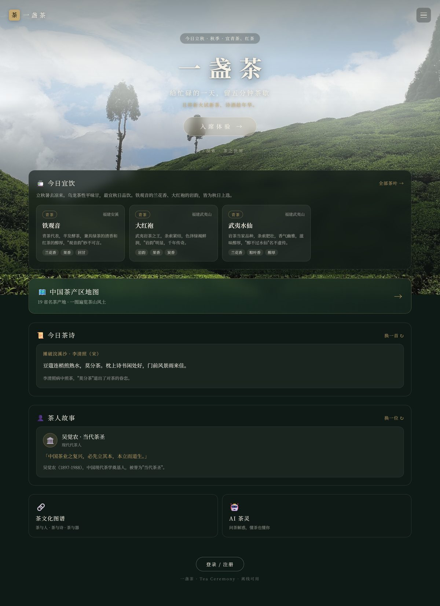
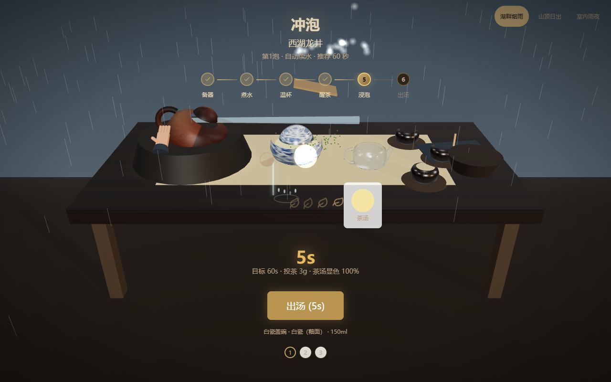
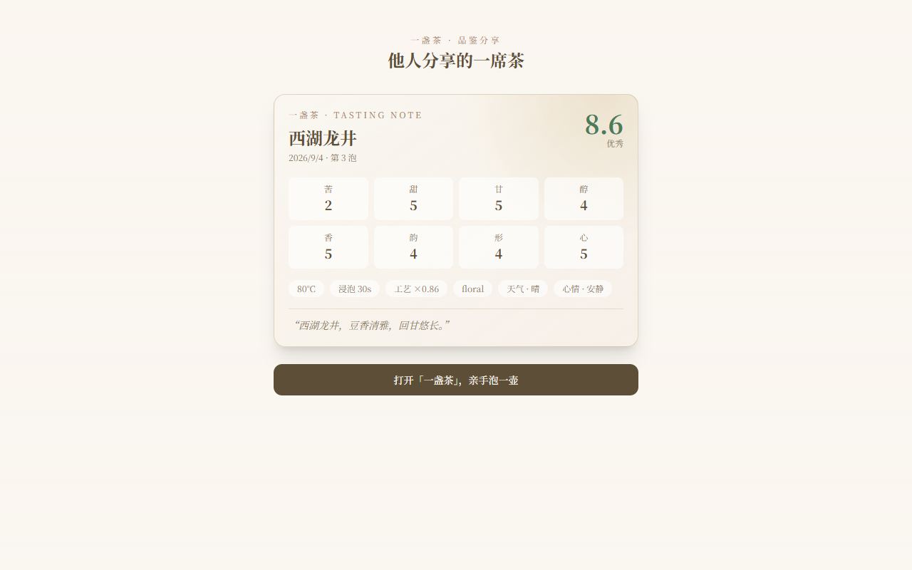
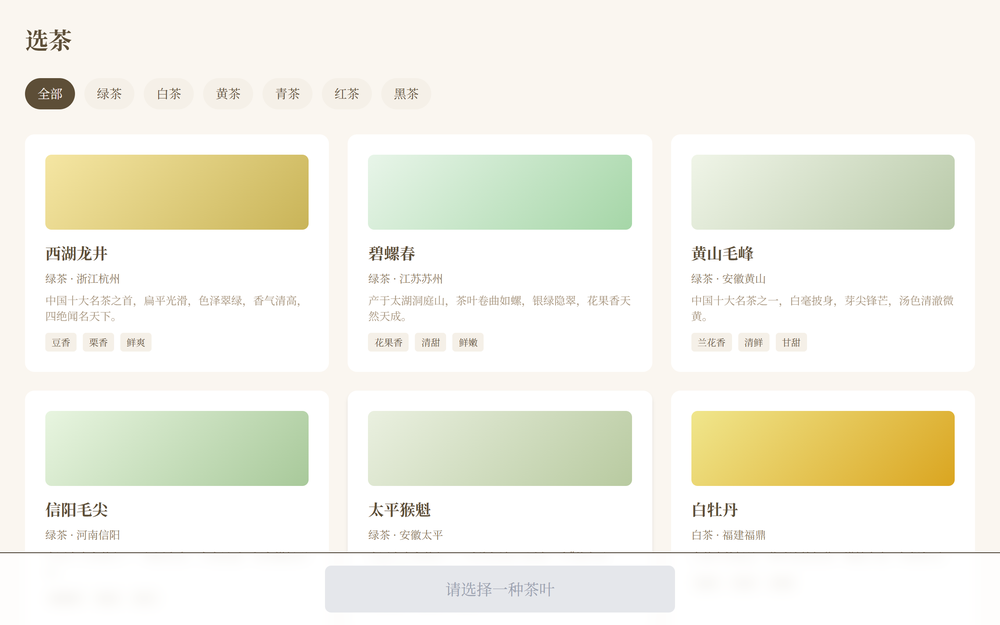
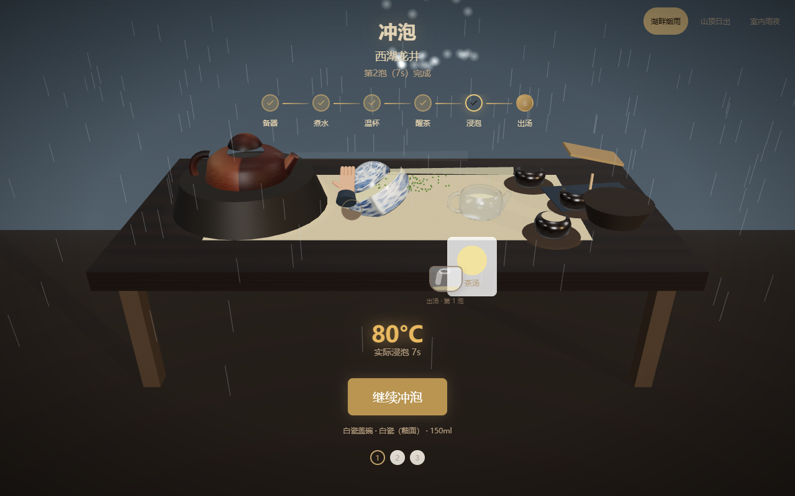
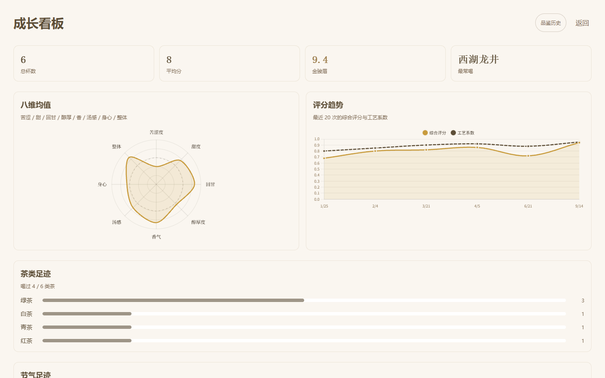

# Tea Ceremony · 一盏茶

> One tea, one room, one quiet moment.

An immersive online tea ceremony: enter the room, pick a tea, boil water, brew, and taste — a complete gongfu cha session in the browser.
Not an encyclopedia, not a timer. A digital tea room you can actually walk into.

**A 3D table makes every step visible; eight-dimension scoring makes every session memorable; offline-first means this tea never waits on connectivity.**

[](LICENSE)
[](https://vuejs.org/)
[](README.en.md)
[](README.en.md)

[](https://github.com/qiuqianyi66/tea-ceremony/actions/workflows/ci.yml)

[中文](README.md) · **English** · [Overview](#what-it-is) · [Screens](#screens) · [Stack](#stack) · [Quick start](#quick-start) · [Deploy](DEPLOY.md) · [Design spec](DESIGN_SPEC.md)

## Try it now

👉 **Live demo (no signup, works offline)**：[qiuqianyi66.github.io/tea-ceremony](https://qiuqianyi66.github.io/tea-ceremony/)
👉 **Full version (with backend, public deployment)**：[https://42.121.125.4](https://42.121.125.4/)


## What it is

Most "tea culture" apps stop at articles and photos. Tea Ceremony turns culture into something you *do*:

- **3D tea table**: TresJS / Three.js renders a wooden table with real teaware — steam on pour, liquor color on outflow, time / solar term / themed room shaping the mood
- **Full loop**: prepare → boil → warm → awaken → brew → observe color → smell → taste, scored by an 8-dimension mouthfeel model × brewing-craft coefficient
- **Offline-first**: Dexie.js + IndexedDB, records land locally first, sync when back online
- **Shareable**: one-tap tasting card with QR code / read-only share link / PNG — send this session to a friend
- **AI tea spirit**: five specialist roles (tea selection / brewing / tasting / tea culture / growth mentor) + multi-tool agent + SSE streaming replies + cross-session long-term memory; RAG vector retrieval with self-hosted local embedding (answers are traceable), gracefully falling back to rule-based replies when offline

## Screens

| Immersive home | 3D brewing | Tasting card |
| --- | --- | --- |
|  |  |  |





## Who it's for

1. **Tea beginners** who want guidance and atmosphere, not a wall of taxonomy
2. **Regular drinkers** who want to record and build a personal archive
3. **Slow-living folks** who want a five-minute, undistracted break

No ads, no paywall, self-hostable, offline-capable.

## Stack

| Layer | Tech |
| --- | --- |
| Frontend | Vue 3 + TypeScript (strict) + Pinia + Vue Router + Tailwind CSS + Vite |
| 3D | Three.js / TresJS (KTX2 compressed textures, basis transcoder) |
| Data | Dexie.js + IndexedDB (offline-first, `sync_status` retry queue); PostgreSQL + pgvector (RAG vector retrieval) + user_memory (cross-session memory) |
| Backend | Spring Boot 3.5 + Spring Data JPA + Spring AI Alibaba + Flyway (legacy FastAPI maintenance-only) |
| AI | Backend proxy only (`/api/v1/ai/*`, browser never calls third-party AI directly); five specialist roles + multi-tool agent + SSE streaming + cross-session memory; RAG vector retrieval (self-hosted bge-large-zh-v1.5 ONNX local embedding + pgvector cosine, DashScope remote fallback); circuit-breaker fallback + request_id tracing |
| Deploy | Docker Compose (frontend / backend / postgres / nginx), public ECS online, GitHub Pages static demo |
| Tests | Vitest + fake-indexeddb, Playwright E2E + axe, full Maven suite (Testcontainers + ArchUnit + LayerDependency), pytest (legacy) |
| CI | GitHub Actions, 14 jobs: type-check+build+smoke / Vitest / Biome / dependency audit / gitleaks / E2E / axe a11y / backend syntax / pytest / ruff+bandit / Spring Boot Maven / migration round-trip / compose validation / harness consistency |

## Engineering quality & governance

Process, rules and verification are written as code. Machines check them, not willpower.

- **AI collaboration rules**: `AGENTS.md` defines red lines, the dev process and a three-track triage (Fast / Guided / Controlled) — decompose first, then act, then verify
- **Architecture decision records**: ADR-001~029 (29 records), every choice documented with "why A, why not B, when to reverse"; rejected options stay on record too (e.g. Graph orchestration, 0/4 after four-dimension screening); the newest cover self-hosted local embedding (ADR-029) and cross-session memory (ADR-028)
- **Skill system**: 66 general/domain skills (`.agents/skills`) + 39 process-family skills (`.harness/skills`), loaded on demand, governed by README routing tables
- **CI merge gate**: all 14 jobs green before merge — type-check / unit / lint / dependency audit / gitleaks / E2E / a11y / backend dual-stack tests / migration round-trip / compose validation / harness consistency
- **Deterministic health checks**: `verify-harness.cjs` (ADR/CI/skills/paths consistency, expects ERRORS: []), `audit-redlines.cjs` (red-line mechanization), `audit-wiki-drift.cjs` (API contract cross-check), `audit-context-budget.cjs` (resident-context token budget)
- **AI eval loop**: 50-case eval set + LLM-as-Judge full scoring; v9 full real score 0.86 (2026-10-30, judgeCoverage 0.97), RAG hit rate 0.48 (recall@k=3/3); methodology rule: only versions with judgeCoverage ≥ 0.95 are citable (v8 0.95 baseline on record)
- **Branch protection**: main is PR-only, merge requires a green CI

## Quick start

Frontend only (start here):

```bash
npm install
npm run dev
```

Full stack (Docker Compose: PostgreSQL + Spring Boot backend):

```bash
cp .env.example .env        # on Windows PowerShell: Copy-Item .env.example .env; edit POSTGRES_PASSWORD, JWT_SECRET, DB_PASSWORD
docker compose up -d --build
# frontend http://localhost:5173, backend http://localhost:18080
```

Common: `npm run type-check` · `npm run test` · `npm run build` · `npm run test:e2e`
Backend tests: `cd backend && mvn -q test` (legacy FastAPI stack: `python -m pytest tests -q`)

Docs: [DEPLOY.md](DEPLOY.md) · [CONTEXT.md](CONTEXT.md) · [DESIGN_SPEC.md](DESIGN_SPEC.md) · [3D_SPEC.md](3D_SPEC.md)

## Contributing

Start with a Good First Issue — adding a tea, translating a string, writing a test, drawing an icon all count.
See [CONTRIBUTING.md](CONTRIBUTING.md). Issue and PR templates are in place.

## Roadmap

- Replace placeholder teaware with real photography
- Expand tea catalog from 66 to 100+ Chinese teas
- Two-person shared sessions (evolve the read-only share card into a live tea party)
- Production Sentry error tracking + Redis rate limiting

## Credits

Home hero `src/assets/tea-mountain-hero.jpg`: photographer Tanmoy281, via [Wikimedia Commons](https://commons.wikimedia.org/wiki/File:Darjeeling-tea-plantation.jpg), [CC BY-SA 4.0](https://creativecommons.org/licenses/by-sa/4.0/deed.zh); resized and tone-mapped for morning-mist effect.
Tea photography: Pexels, commercially licensed.

## License

[MIT](LICENSE) © 2026 Yan Heng (qiuqianyi66)
