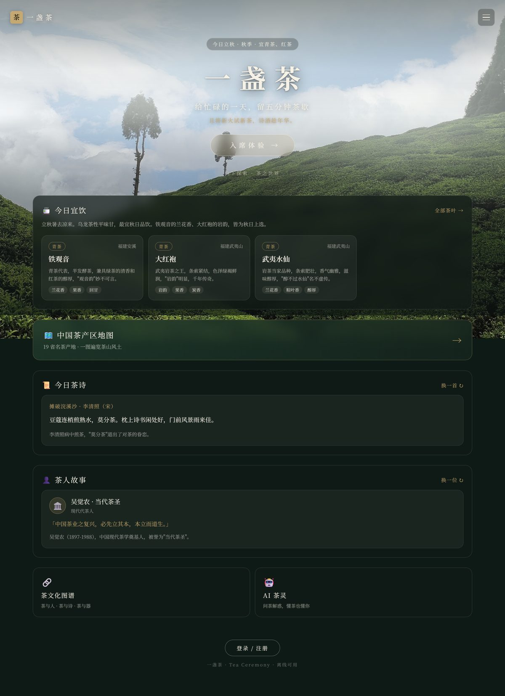
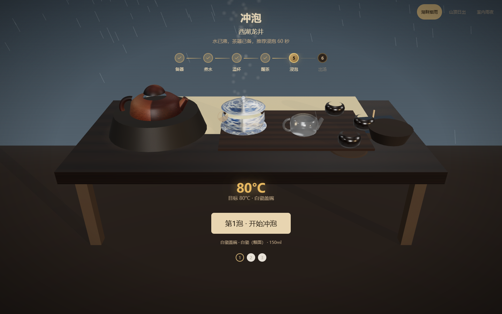
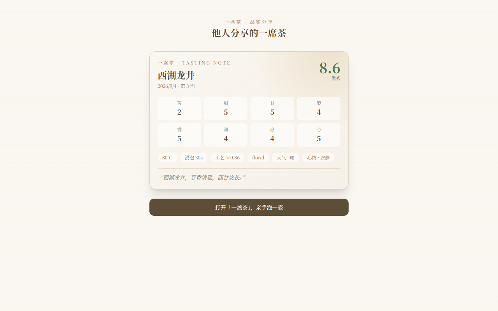
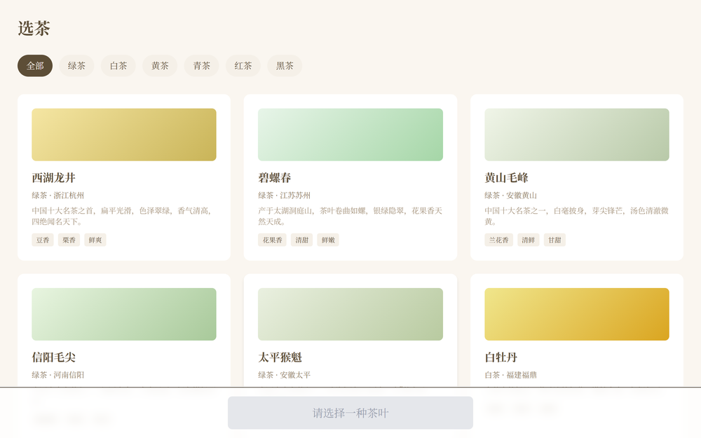
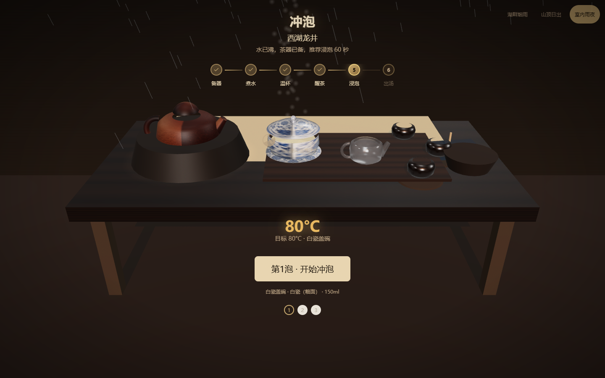
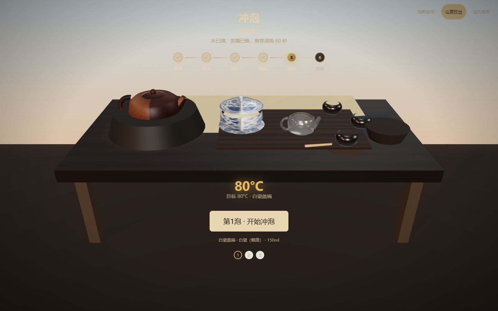
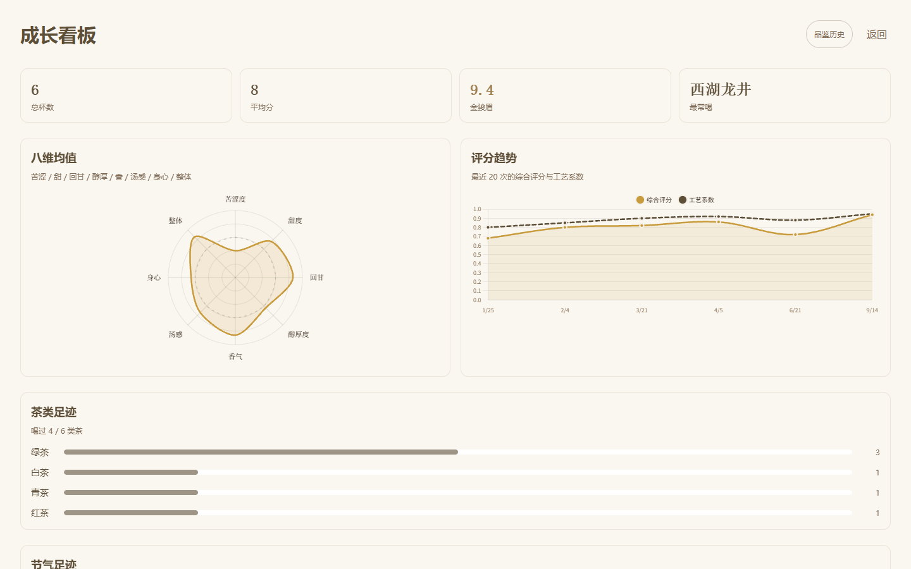

# Tea Ceremony · 一盏茶

> An immersive online tea ceremony app: **Vue 3 + Spring Boot 3 + Spring AI Alibaba full-stack project** with a 3D tea table, offline-first PWA, self-hosted RAG vector retrieval, SSE streaming AI chat, and cross-session long-term memory. One tea, one room, one quiet moment.

Imagine: open the browser, wooden table, Yixing clay teapot, 85°C spring water pouring in, steam rising, liquor color deepening. After the session, eight-dimension mouthfeel scores are recorded; next time the AI tea spirit remembers your taste.

Tea Ceremony is an open-source web tea ceremony app. Not a tea encyclopedia, not a brewing timer: picking a tea, boiling water, brewing, tasting — the whole loop runs on one 3D tea table, online or not.

**Common search terms**: online tea ceremony · 3D tea brewing web app · open-source tea app · Vue 3 + Three.js 3D scene · Spring AI RAG

## Citable summary

> Tea Ceremony (一盏茶) is an open-source web tea ceremony app that renders an interactive 3D tea table with Vue 3.5 and Three.js, backed by Spring Boot 3.5 + Spring AI Alibaba for RAG Q&A and a multi-tool agent, offline-first via Dexie.js, MIT licensed, with a no-signup live demo.

| Field | Value |
| --- | --- |
| Name | Tea Ceremony · 一盏茶 |
| Author | Yan Heng (GitHub [qiuqianyi66](https://github.com/qiuqianyi66)) |
| License | MIT |
| Live demo | [qiuqianyi66.github.io/tea-ceremony](https://qiuqianyi66.github.io/tea-ceremony/) |
| Repository | [github.com/qiuqianyi66/tea-ceremony](https://github.com/qiuqianyi66/tea-ceremony) |
| Stack in one line | Vue 3.5 + TypeScript 6 + TresJS/Three.js + Spring Boot 3.5 + Spring AI Alibaba + PostgreSQL/pgvector |
| Status | Phases 1-5, visual upgrade and P0/P1 polish done; currently in production-grade hardening (V4 docs layering + quality gates) |

## Quick facts

| Item | Fact |
| --- | --- |
| What it is | An immersive online tea ceremony app. Not an encyclopedia, not a brewing timer |
| Live demo | [qiuqianyi66.github.io/tea-ceremony](https://qiuqianyi66.github.io/tea-ceremony/) (no signup, works offline) |
| Frontend | Vue 3.5 · TypeScript 6 (strict) · Pinia 4 · Tailwind CSS 4 · Vite 8 |
| 3D | Three.js 0.185 · TresJS 5.8; teaware is built from parametric Lathe / Box geometry plus procedural Canvas textures, zero external model assets |
| Backend | Spring Boot 3.5 · Spring Data JPA · Spring AI Alibaba · PostgreSQL + pgvector |
| Offline | Dexie.js + IndexedDB offline-first; records land locally, sync via `sync_status` when online |
| Tests and gates | Vitest · Playwright E2E · axe a11y · Maven Testcontainers · ArchUnit layering; 14 CI merge-gate jobs |
| Engineering docs | 30 ADRs, each recording "why A, why not B, when to reverse" |
| Scale | 66 teas · 21 routes · 3 tea-room skins (lake rain / mountain dawn / indoor storm) |
| License | MIT. Commercial use and forks allowed, keep the copyright notice |

**Who are you?**

| Just want to try | Developer running it locally | Checking the stack / resume project |
| --- | --- | --- |
| 👉 [Live demo](https://qiuqianyi66.github.io/tea-ceremony/) (works offline) | 👉 [Quick start](#quick-start) | 👉 [Tech stack](#tech-stack) · [AI capabilities](#ai-capabilities) · [Engineering quality](#engineering-quality) |

[](LICENSE)
[](https://vuejs.org/)
[](README.en.md)
[](README.en.md)

[](https://github.com/qiuqianyi66/tea-ceremony/actions/workflows/ci.yml)

[中文](README.md) · **English**

## Table of contents

- [Citable summary](#citable-summary)
- [What it is](#what-it-is)
- [How it differs from other tea apps](#how-it-differs-from-other-tea-apps)
- [Try it](#try-it)
- [What you can do](#what-you-can-do)
- [Screenshots](#screenshots)
- [Tech stack](#tech-stack)
- [AI capabilities](#ai-capabilities)
- [Project structure](#project-structure)
- [Quick start](#quick-start)
- [Engineering quality](#engineering-quality)
- [FAQ](#faq)
- [Roadmap](#roadmap)
- [Credits](#credits)
- [License](#license)

## What it is

Tea Ceremony is not an encyclopedia and not a timer. It is a digital tea room you can actually walk into.

Full loop: enter the room → pick a tea → prepare teaware → boil water → brew → tasting record → personal growth. Frontend renders an interactive 3D tea table with Vue 3 + Three.js; backend serves RAG Q&A and a multi-tool agent with Spring Boot 3.5 + Spring AI Alibaba; PostgreSQL + pgvector powers vector retrieval.

## How it differs from other tea apps

- Not a tea encyclopedia: the 66 tea entries are the raw material; what gets recorded is how this infusion was brewed and how it tasted.
- Not a brewing timer: the timer is one step inside a loop that runs prepare, boil, warm, awaken, brew, watch the color, smell, taste.
- No external 3D model assets: teaware is generated at runtime from parametric geometry and procedural textures, so there are no glb files or texture packs to download.
- No browser-to-AI calls: every request goes through the `/api/v1/ai/*` backend proxy, and falls back to local rule-based replies when unavailable.

## Try it

- **Live demo (no signup, works offline)**: [qiuqianyi66.github.io/tea-ceremony](https://qiuqianyi66.github.io/tea-ceremony/)
- **Full version (with backend, public deployment)**: [https://42.121.125.4](https://42.121.125.4/)


## What you can do

- **3D tea table**: TresJS / Three.js renders a wooden table with real teaware — steam on pour, liquor color on outflow, time / solar term / themed room shaping the mood
- **Full loop**: prepare → boil → warm → awaken → brew → observe color → smell → taste, scored by an 8-dimension mouthfeel model × brewing-craft coefficient
- **Offline-first PWA**: Dexie.js + IndexedDB, records land locally first, sync when back online via `sync_status` retry queue
- **Shareable**: one-tap tasting card with QR code / read-only share link / PNG
- **AI tea spirit**: five specialist roles + multi-tool agent + SSE streaming replies + cross-session long-term memory; RAG answers are traceable
- **Engineering**: 30 ADRs, ArchUnit layered tests, Testcontainers integration tests; the 14 CI gate jobs are listed under [Engineering quality](#engineering-quality)

## Screenshots

| Immersive home | 3D brewing | Tasting card |
| --- | --- | --- |
|  |  |  |






Screenshots are captured by repo scripts: `node scripts/verify-brew-mobile.cjs` (390×844) and `node scripts/verify-brew-desktop.cjs` (1440×900).

## Tech stack

| Layer | Tech |
| --- | --- |
| Frontend | Vue 3.5 + TypeScript 6 (strict) + Pinia 4 + Vue Router + Tailwind CSS 4 + Vite 8 |
| 3D | Three.js 0.185 + TresJS 5.8 (KTX2 compressed textures, basis transcoder) |
| Client data | Dexie.js + IndexedDB (offline-first) |
| Backend | Spring Boot 3.5 + Spring Data JPA + Spring AI Alibaba + Flyway migrations |
| AI framework | Spring AI Alibaba (multi-tool agent, SSE streaming, Advisor memory) |
| Vector | PostgreSQL + pgvector (HNSW index, cosine distance) |
| Local embedding | Self-hosted bge-large-zh-v1.5 ONNX (1024 dim, onnxruntime 1.31.1) |
| Legacy backend | FastAPI (maintenance-only, no new features) |
| Deploy | Docker Compose (frontend / backend / postgres / nginx) |
| Static host | GitHub Pages (frontend demo) |
| Tests | Vitest + Playwright E2E + axe a11y + Maven Testcontainers + ArchUnit |
| CI | GitHub Actions 14 jobs (type-check / Vitest / Biome / gitleaks / E2E / a11y / backend Maven / pytest / migration round-trip / compose validation / harness consistency) |

## AI capabilities

- **Five specialist roles**: tea picker, brewer, taster, culture scholar, growth mentor
- **Multi-tool agent**: Spring AI Alibaba Tool Calling, backend registers tools the model can invoke
- **SSE streaming**: frontend `EventSource` receives the token stream, typewriter replies
- **Cross-session long-term memory**: `user_memory` table stores user profile, injected into system prompt on the next session
- **Self-hosted RAG**: 8 culture tables are chunked → ONNX embedding → pgvector cosine retrieval → prompt context; answers carry source citations
- **Circuit breaker**: the browser never calls third-party AI directly; all requests go through the `/api/v1/ai/*` backend proxy; offline falls back to local rule-based replies
- **Eval loop**: 50-case eval set + LLM-as-Judge full scoring; v9 real score **0.86** (2026-10-30, judgeCoverage 0.97), RAG hit rate **0.48** (recall@k=3/3)

## Project structure

```
tea-ceremony/
├── src/                        # Vue 3 frontend (Vite)
│   ├── views/                  # Pages (3D brewing, AI chat, growth, share…)
│   ├── stores/                 # Pinia (auth / progress / brew / tasting)
│   ├── services/               # Backend proxy + offline fallback
│   ├── components/three/      # TresJS tea table (visual layer only, no state)
│   └── router/                 # 21 routes
├── backend/                    # Spring Boot 3.5 backend
│   ├── src/main/java/com/tea/  # Controller → Service → Repository
│   └── src/test/               # Testcontainers + ArchUnit + LayerDependency
├── docs/                       # ADR-001~030, plans, eval evidence
├── .agents/skills/            # 66 general / domain skills
├── .harness/                   # 43 process-family skills + rules + wiki
├── deploy/                     # Docker Compose, nginx, observability
└── .github/workflows/ci.yml    # 14-job merge gate
```

## Quick start

Frontend only (start here):

```bash
npm install
npm run dev
```

Full stack (Docker Compose: PostgreSQL + Spring Boot backend):

```bash
cp .env.example .env        # on Windows PowerShell: Copy-Item .env.example .env; edit POSTGRES_PASSWORD, JWT_SECRET, DB_PASSWORD
docker compose up -d --build
# frontend http://localhost:5173, backend http://localhost:18080
```

Common: `npm run type-check` · `npm run test` · `npm run build` · `npm run test:e2e`
Backend tests: `cd backend && mvn -q test` (legacy FastAPI stack: `python -m pytest tests -q`)

### Environment variables

Full list in [.env.example](.env.example). Core required:

| Variable | Required | Purpose |
| --- | --- | --- |
| `POSTGRES_PASSWORD` | Yes | PostgreSQL password; keep consistent with `DB_PASSWORD` |
| `DB_URL` / `DB_USER` / `DB_PASSWORD` | Yes | Spring Boot datasource (use `db:5432` inside Docker Compose) |
| `JWT_SECRET` | Yes | JWT signing key, ≥32 bytes; backend fails to start if missing (fail-closed) |
| `AI_GATEWAY_API_KEY` | Yes | Production AI gateway key; Compose hard-fails if missing |
| `ADMIN_API_TOKEN` | No | Separate token for admin endpoints; `/api/v1/admin/**` returns 401 if unset |
| `AI_DASHSCOPE_API_KEY` | No | DashScope remote fallback; otherwise self-hosted ONNX + gateway |
| `VITE_API_URL` | No | Frontend→backend URL, default `/api` (Nginx proxy) |

Docs: [DEPLOY.md](DEPLOY.md) · [CONTEXT.md](CONTEXT.md) · [DESIGN_SPEC.md](DESIGN_SPEC.md) · [3D_SPEC.md](3D_SPEC.md)

## Engineering quality

Process, rules and verification are written as code. Machines check them, not willpower.

- **AI collaboration rules**: `AGENTS.md` defines red lines, dev process and a three-track triage (Fast / Guided / Controlled)
- **Architecture decision records**: ADR-001~030, every choice documented with "why A, why not B, when to reverse"; the newest cover self-hosted local embedding (ADR-029) and cross-session memory (ADR-028)
- **CI merge gate**: all 14 jobs green before merge; main is PR-only
- **Deterministic health checks**: `verify-harness.cjs` / `audit-redlines.cjs` / `audit-wiki-drift.cjs` / `audit-context-budget.cjs`, wired into CI
- **Layering**: ArchUnit enforces Controller → Service → Repository one-way dependency

## FAQ

### Q: What is this project, and who is it for?

A: A web app where you can actually walk through a full tea-brewing session. Anyone curious about a tea table can use the demo as-is. Developers looking at 3D frontends, AI application plumbing or full-stack process design can read the repo, because the workflow, gates and decision records all live here.

### Q: Is there an open-source 3D tea-brewing or online tea ceremony web app?

A: Yes — this one. The tea table, teaware, pouring steam and liquor color all render live in the browser, with no external glb model assets. Open the demo and it runs, no signup.

### Q: Can I use this as a Vue 3 + Three.js 3D scene reference?

A: Yes. The 3D layer only does visuals (`src/components/three/`), the state machine lives in Pinia, and neither intrudes on the other. Declarative TresJS components, parametric geometry and Canvas procedural textures are documented in `3D_SPEC.md` and the ADRs.

### Q: Does it work without a network connection?

A: The frontend is an offline-first PWA. After the first load you can pick teas, brew and record tastings offline; records live in IndexedDB and sync through the `sync_status` queue when the network returns. AI Q&A degrades to local rule-based replies.

### Q: What is the tech stack?

A: Vue 3.5 + TypeScript + Pinia + Tailwind + Vite frontend; Spring Boot 3.5 + Spring AI Alibaba + PostgreSQL/pgvector backend; Three.js for 3D; Docker Compose deployment; GitHub Actions CI.

### Q: Does the 3D tea table use model assets?

A: No external models. Teaware is generated at runtime from parametric geometry (Lathe profiles, Box, Cylinder) plus procedural Canvas textures, so the repo carries no multi-megabyte glb files and no texture packs to download.

### Q: How is the AI implemented?

A: Spring AI Alibaba provides the multi-tool agent, SSE streaming replies and Advisor memory. RAG embeds culture knowledge with self-hosted bge-large-zh-v1.5 ONNX, stores vectors in pgvector, and retrieves by cosine. User profile is stored in the `user_memory` table for cross-session reuse.

### Q: Does it work offline?

A: Yes. The frontend is offline-first with Dexie.js + IndexedDB; tasting records write locally first and sync when back online via the `sync_status` retry queue. When AI is unavailable, the UI falls back to local rule-based replies.

### Q: Is the backend Spring Boot or FastAPI?

A: The primary backend is Spring Boot 3.5 (Spring Data JPA + Spring AI Alibaba + Flyway). The legacy FastAPI stack is maintenance-only, no new features.

### Q: How do I run it locally?

A: Frontend only: `npm install && npm run dev`. Full stack: `cp .env.example .env` then `docker compose up -d --build`.

### Q: Why self-hosted embedding instead of DashScope?

A: The DashScope account is out of credit and unrecoverable; self-hosted ONNX is the only path to re-enable vector RAG. See ADR-029 (model: bge-large-zh-v1.5, 1024-dim, no schema migration needed).

### Q: How is it deployed?

A: Docker Compose orchestrates four containers (frontend / backend / postgres / nginx); the static frontend demo is deployed to GitHub Pages. See [DEPLOY.md](DEPLOY.md) for the full flow.

### Q: Can I use it commercially or build on it?

A: Yes. MIT license; keep the copyright notice. Changes and republishing do not have to be contributed back.

## Roadmap

- Replace placeholder teaware with real photography
- Expand tea catalog from 66 to 100+ Chinese teas
- Two-person shared sessions (evolve the read-only share card into a live tea party)
- Production Sentry error tracking + Redis rate limiting

## Credits

Home hero `src/assets/tea-mountain-hero.jpg`: photographer Tanmoy281, via [Wikimedia Commons](https://commons.wikimedia.org/wiki/File:Darjeeling-tea-plantation.jpg), [CC BY-SA 4.0](https://creativecommons.org/licenses/by-sa/4.0/deed.en); resized and tone-mapped for a morning-mist effect.
Tea photography: Pexels, commercially licensed.

## License

[MIT](LICENSE) © 2026 Yan Heng (qiuqianyi66)
